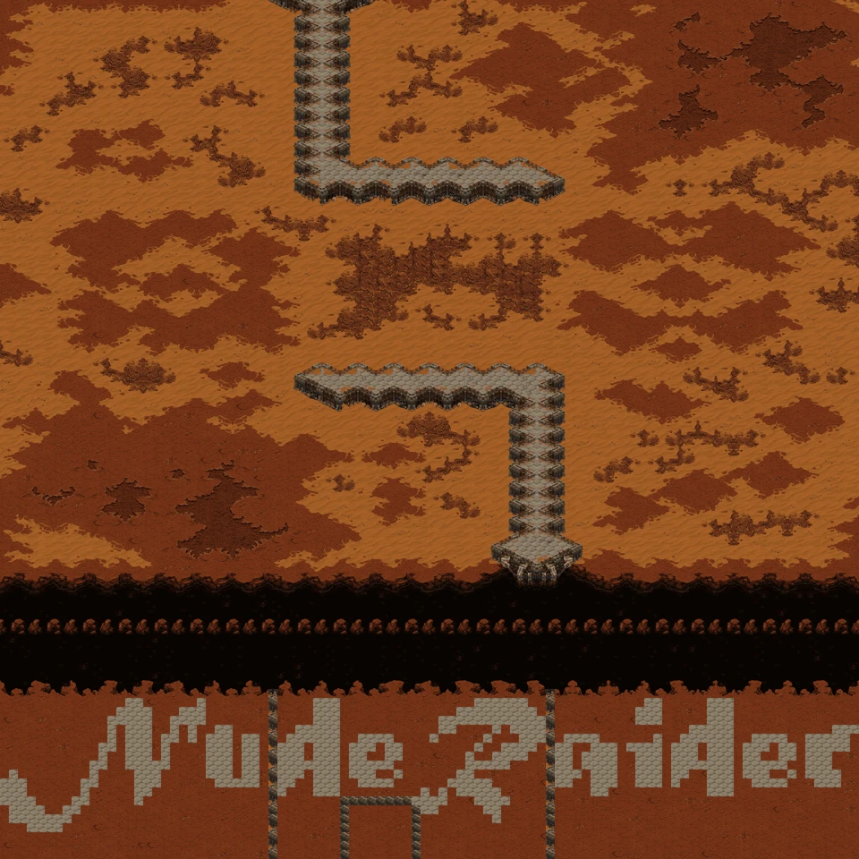
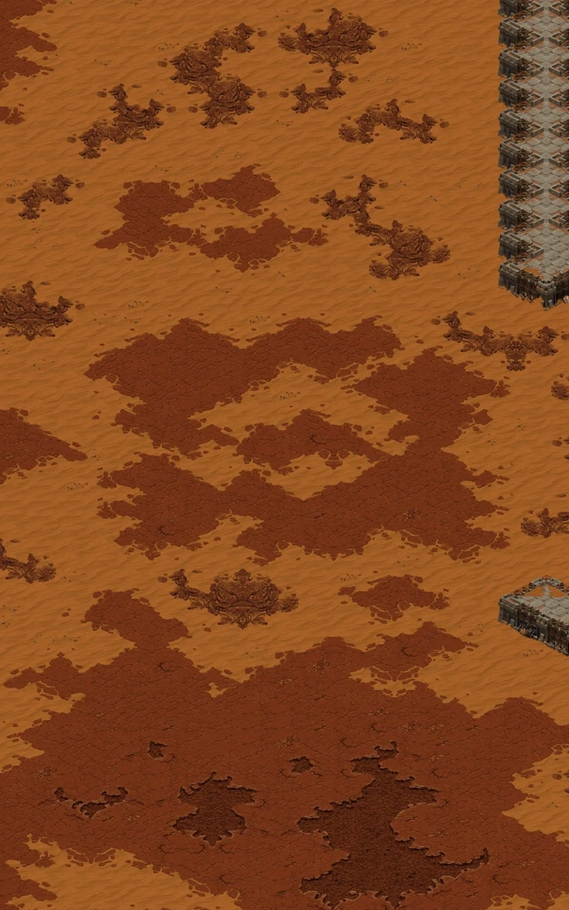

# Desert Strike integration — v0.15.0

> Historical v0.15.0 integration record. Its Machine Shop row records the original 600-mineral UNIx cost only; it is not a current purchase permission. Its symmetric Spawning Pool threshold of 6 is superseded. Current building availability, costs, functions and production are maintained in the [README catalog](../README.md#원본-기준-건물생산-편성) and [generated original audit](desertstrike-original-audit.md).

## Delivered

- SHA-256-verified original SCX/CHK and complete 328-record audit: [trigger audit](desertstrike-original-audit.md), [decoded source](../resources/original-desertstrike.json).
- Mineral-only construction, 300 initial minerals per side, separate 16-hyper-cycle income, one-shot investment delays and 5 occupied/reserved geyser limits.
- Source action counts and properties, cumulative completed-building waves, separate arbiter producer/active-unit limits.
- Shared payment/prerequisite/geometry/construction paths for player and AI; continuing economy/technology/composition decisions; visible enemy production view.
- Original Desert terrain reconstructed from MTXM/CV5/VX4EX/VR4/WPE. Connected tile transitions are preserved when rotating the battlefield; production uses the audited upper-left crop.
- Same crystal formation main and temple outpost on both sides; no free tower garrisons; one-time outpost reinforcement. Paid defenses project into the battlefield after completion and share lifetime with their producer.
- Consumed Heal & Repair, Mind Control and finite Broodling effects; no repeated snapshot/recursive bunker exploit.

## Trigger classification

| Classification | Count |
|---|---:|
| 변환 적용 | 121 |
| 제외 | 93 |
| 적용 | 30 |
| 버그 수정 | 84 |

Every trigger is listed individually in the audit, including excluded engine, 3v3, leaver, development and civilian/nuclear proxy triggers. Tank creation is 3 on both sides; property indices 4 versus 8 caused the apparent count discrepancy. This historical report normalized the pool bonus threshold to 6 on both sides; current source-derived thresholds are team 0=6 and team 1=8.

## Building costs and actual outputs

| Building | Minerals | Wave |
|---|---:|---|
| 커맨드 센터 (106) | 200 | No automatic unit output |
| 콤샛 스테이션 (107) | 900 | 사이언스 베슬 ×1 |
| 뉴클리어 사일로 (108) | 500 | 고스트 ×4 |
| 서플라이 디포 (109) | 150 | 벌처 ×2 |
| 리파이너리 (110) | 600 | No automatic unit output |
| 배럭 (111) | 330 | 마린 ×6 |
| 아카데미 (112) | 250 | 파이어뱃 ×1 · 메딕 ×1 |
| 팩토리 (113) | 600 | 골리앗 ×3 |
| 스타포트 (114) | 550 | 레이스 ×2 |
| 컨트롤 타워 (115) | 2750 | No automatic unit output |
| 사이언스 퍼실리티 (116) | 200 | No automatic unit output |
| 코버트 옵스 (117) | 1000 | 시즈 탱크 ×3 |
| 피직스 랩 (118) | 1500 | 배틀크루저 ×2 |
| 머신샵 (120) | 600 | No automatic unit output |
| 엔지니어링 베이 (122) | 50 | No automatic unit output |
| 아머리 (123) | 1000 | 발키리 ×2 |
| 미사일 터렛 (124) | 200 | No automatic unit output |
| 벙커 (125) | 300 | No automatic unit output |
| 해처리 (131) | 100 | No automatic unit output |
| 레어 (132) | 360 | 러커 ×2 |
| 하이브 (133) | 400 | 러커 ×2 · 오버로드 ×1 |
| 나이더스 커널 (134) | 3000 | No automatic unit output |
| 히드라리스크 덴 (135) | 250 | 히드라리스크 ×3 |
| 디파일러 마운드 (136) | 600 | 디파일러 ×2 |
| 그레이터 스파이어 (137) | 200 | 가디언 ×1 · 디바우러 ×1 |
| 퀸즈 네스트 (138) | 350 | 퀸 ×1 |
| 에볼루션 챔버 (139) | 0 | No automatic unit output |
| 울트라리스크 캐번 (140) | 350 | 울트라리스크 ×1 |
| 스파이어 (141) | 260 | 뮤탈리스크 ×1 · 스커지 ×2 |
| 스포닝 풀 (142) | 50 | 저글링 ×5 |
| 크립 콜로니 (143) | 0 | No automatic unit output |
| 스포어 콜로니 (144) | 200 | No automatic unit output |
| 성큰 콜로니 (146) | 200 | No automatic unit output |
| 익스트랙터 (149) | 500 | No automatic unit output |
| 넥서스 (154) | 200 | No automatic unit output |
| 로보틱스 퍼실리티 (155) | 0 | No automatic unit output |
| 파일런 (156) | 100 | No automatic unit output |
| 어시밀레이터 (157) | 600 | No automatic unit output |
| 옵저버토리 (159) | 700 | 옵저버 ×2 |
| 게이트웨이 (160) | 280 | 질럿 ×4 |
| 포톤 캐논 (162) | 250 | No automatic unit output |
| 시타델 오브 아둔 (163) | 675 | 다크 템플러 ×1 · 다크 아콘 ×1 |
| 사이버네틱스 코어 (164) | 350 | 드라군 ×2 |
| 템플러 아카이브 (165) | 700 | 아콘 ×1 · 하이 템플러 ×1 |
| 포지 (166) | 0 | No automatic unit output |
| 스타게이트 (167) | 1100 | 스카웃 ×2 · 커세어 ×1 |
| 플릿 비콘 (169) | 800 | 캐리어 ×1 |
| 아비터 트리뷰널 (170) | 1000 | 아비터 ×1 |
| 로보틱스 서포트 베이 (171) | 1200 | 리버 ×2 |
| 실드 배터리 (172) | 3500 | No automatic unit output |

## Economy and geometry

| Gas facilities | Income / 1.344 seconds | Added one-shot delay |
|---|---:|---:|
| 0 | 10 | 0 cycles (0.000 s) |
| 1 | 12 | 0 cycles (0.000 s) |
| 2 | 15 | 333 cycles (27.972 s) |
| 3 | 18 | 347 cycles (29.148 s) |
| 4 | 22 | 667 cycles (56.028 s) |
| 5 | 26 | 655 cycles (55.020 s) |

Gas costs: Terran/Protoss 600, Zerg 500 minerals. Source geyser centers: `(64,32), (192,32), (320,32), (64,96), (64,160)`. The same translation maps the crop and geysers; enemy uses the mirrored crop. Fixed reservation starts at construction initiation and is released on cancellation/destruction. Skipped exact-count delay triggers are not charged when multiple facilities finish together.

Original map: 96×96 / 3072×3072. Playing field location 19 is 3072×2080. The separate spawn buffers are not production regions. The original map allows shared team-territory construction; it does not specify an exclusive per-player rectangle. MiniStar uses a declared 33×19 crop (1056×608), with 606 CV5/VF4-buildable cells before geysers/structures. This is an adaptation, not an original per-player area claim.

## Paid AI development

The following are economy/construction simulations with actual wave deployment. Armies are retired between waves to isolate economic growth; these are not combat win-rate or full 15-minute battlefield measurements. Nine player/enemy race combinations passed. Full metrics: [simulation JSON](desertstrike-ai-simulation.json).

| Enemy | Wave | Gas | Producers | Units deployed | Combat value | Income / spent / balance |
|---|---:|---:|---:|---:|---|
| terran | 5 | 0 | 2 | 9 | 600 | 1140 / 930 / 510 |
| terran | 10 | 1 | 3 | 11 | 900 | 2380 / 2080 / 600 |
| terran | 20 | 2 | 5 | 16 | 1850 | 5182 / 5080 / 402 |
| terran | 30 | 3 | 9 | 23 | 3000 | 8563 / 8480 / 383 |
| zerg | 5 | 0 | 6 | 19 | 1225 | 1140 / 1320 / 120 |
| zerg | 10 | 1 | 6 | 20 | 1325 | 2430 / 2220 / 510 |
| zerg | 20 | 2 | 12 | 29 | 2425 | 5184 / 5430 / 54 |
| zerg | 30 | 3 | 20 | 47 | 3975 | 8715 / 8710 / 305 |
| protoss | 5 | 0 | 3 | 8 | 1025 | 1140 / 1305 / 135 |
| protoss | 10 | 1 | 4 | 10 | 1175 | 2412 / 2605 / 107 |
| protoss | 20 | 2 | 6 | 15 | 2275 | 5262 / 5505 / 57 |
| protoss | 30 | 3 | 9 | 19 | 2775 | 8874 / 8605 / 569 |

## Validation

- `npm run build`: verified resource bundles plus original SCX/CHK hashes and 328-record audit completeness.
- `npm test`: 85 tests, including all nine race pairings through 30 actual wave deployments.
- `node tests/browser.cjs`: mobile portrait layouts, original five slot touch centers, enemy production display, construction/selection, relative `/ministar/` loading and legacy cache retirement.
- New UI/version is v0.15.0; no offline cache or service worker registration added.

## Remaining fidelity limits

- Original-engine Fastest wall-clock measurement of the countdown is still unavailable. The current 46/1.5-second conversion remains provisional; 46 game seconds in TRIG must not be represented as verified wall time.
- The existing 5% MiniStar construction pacing remains; original engine build pacing has not been replicated.
- Production crop orientation is retained for original building footprints; only battlefield rotates. There is no original exclusive player area to copy verbatim.
- Full UPGx/weapon-bonus, ammunition, nuclear-proxy and objective damage-stage parity is not certified. Existing combat/path/weapon-category regression behavior is preserved.
- Browser tests emulate Android-sized touch viewports on Chromium; physical Android device and sustained 30-wave full-combat profiling remain separate checks.
- Intentional 1v1 exceptions are recorded per trigger; this release is not described as complete engine-identical reproduction.
